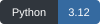
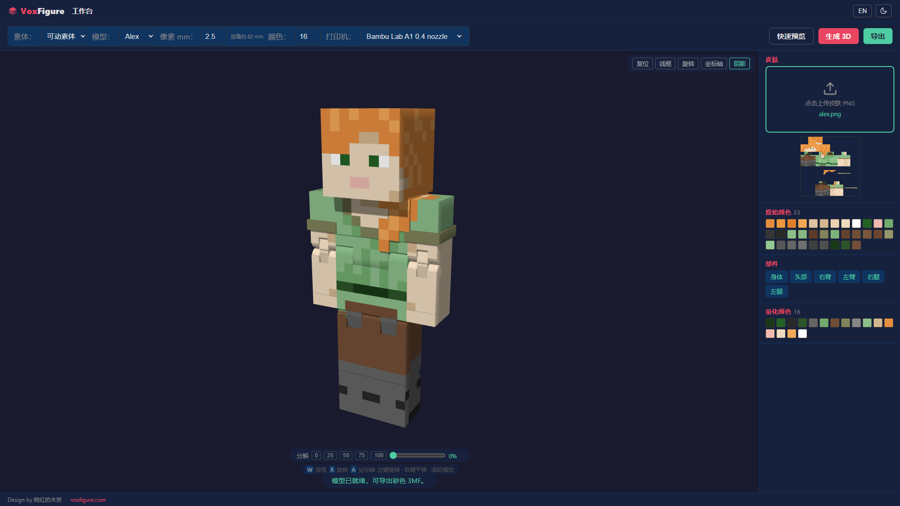

<p align="center">
  <a href="https://voxfigure.com"></a>
</p>
<h1 align="center">VoxFigure</h1>
<p align="center">Convert Minecraft skins into multicolor 3D-printable Steve and Alex articulated figures.</p>
<p align="center"><a href="README.md">简体中文</a> · <strong>English</strong></p>
<p align="center">
  <a href="#getting-started" title="Python 3.12"></a>
  <a href="LICENSE"></a>
  <a href="LICENSE-MODELS"></a>
</p>
<p align="center"><a href="#getting-started">Getting started</a> · <a href="#usage">Usage</a> · <a href="#contributing">Contributing</a> · <a href="https://voxfigure.com">Website</a> · <a href="mailto:voxfigure@163.com">Email</a></p>

<p align="center">
  
  
</p>

VoxFigure provides skin mapping, model preview and multipart color 3MF export. It runs locally without an account or database.

## Features

- Generate printable parts from the included Steve and Alex STEP models, including flat chest pieces and joint pins.
- Read PNG skins with transparency and color quantization. Adjust pixel size and the maximum number of colors.
- Inspect parts with visibility controls, an exploded view, wireframe, axes and lighting. The interface supports Chinese, English, light and dark themes.
- Export multipart color 3MF files from the current skin and settings for use in a slicer.

## Getting started

Use Python 3.12. Create a virtual environment and install dependencies from the repository root.

**Windows PowerShell**

```powershell
py -3.12 -m venv .venv
.\.venv\Scripts\python.exe -m pip install -r requirements.txt
.\.venv\Scripts\python.exe app.py
```

**macOS / Linux**

```sh
python3.12 -m venv .venv
.venv/bin/python -m pip install -r requirements.txt
.venv/bin/python app.py
```

Open http://127.0.0.1:5000 .

The first generation reads the STEP files and builds a geometry cache, which may take a few minutes. Later generations reuse the cache. On Linux, see the [Dockerfile](Dockerfile) for the required system graphics libraries. Once dependencies are installed, the app can run offline; the frontend does not require an external CDN.

<details>
<summary>Docker Compose</summary>

```sh
docker compose up --build
```

Open the same address, http://127.0.0.1:5000 . The default configuration binds to localhost and stores the geometry cache in a named volume. To stop the service:

```sh
docker compose down
```

The Docker configuration has not yet been tested by running it.

</details>

## Usage

1. Upload a PNG skin and choose Steve or Alex.
2. Set the pixel size and color count, then use **Quick Preview** to check the appearance.
3. Select **Generate 3D** to create the actual printable geometry. Regenerate after changing the skin or settings.
4. Download the 3MF from **Export**, then check materials, part placement and supports in your slicer.

Supported skin sizes are `64×64`, `64×32`, `128×128` and `128×64`, up to 2 MB. Pixel size ranges from 1 to 5 mm; the maximum-color setting ranges from 2 to 32.

128-pixel skins use the standard body's existing sampling rules and do not increase geometric resolution. At 2.5 mm per pixel, the full skin outline is approximately 82 mm tall; transparent areas may reduce the actual height.

<details>
<summary>View the workbench</summary>



Real printable-part output using Minecraft's default Alex skin, at 2.5 mm per pixel and 16 colours. See also the [Steve example](docs/media/workbench-steve.png). Skin sources and rights are documented in the [media notes](docs/media/README.md).

</details>

Uploaded skins and temporary exports are removed when the request ends. Downloads regenerate the model from the current skin. The geometry cache defaults to `.cache`; set `VOXFIGURE_CACHE` to use another location.

## Testing

Use the virtual environment created above (Windows PowerShell):

```powershell
.\.venv\Scripts\python.exe -m pip install -r requirements-dev.txt
.\.venv\Scripts\python.exe -m pytest -q
```

Full STEP and 3MF integration tests require CadQuery / OCP and take longer:

```powershell
.\.venv\Scripts\python.exe -m pytest -m cad -q
```

On macOS / Linux, replace the interpreter path with `.venv/bin/python`.

Browser checks are in [tests/browser.cjs](tests/browser.cjs). Environment details, project structure and test instructions are in the [development notes](docs/DEVELOPMENT.md) (Chinese).

## Contributing

Issues and pull requests are welcome. For a bug report, include the operating system, Python version, steps to reproduce and error logs. For generation issues, also include the character, skin dimensions and generation settings.

Read the [development notes](docs/DEVELOPMENT.md) (Chinese) before making changes. Run the relevant tests for functional changes and describe the resulting UI or exported output. Please discuss larger changes in an issue first.

## Contact

- Website: [voxfigure.com](https://voxfigure.com)
- Email: [voxfigure@163.com](mailto:voxfigure@163.com)

## Licenses

- Project code: [AGPL-3.0-only](LICENSE).
- Standard Steve / Alex models: [CC BY-SA 4.0](LICENSE-MODELS).
- Third-party files retain their own licenses; see [THIRD_PARTY_NOTICES.txt](THIRD_PARTY_NOTICES.txt).

See [LICENSING.md](LICENSING.md) for scope, model attribution and generated-file notes. The model line artwork and animation in this README are also licensed under CC BY-SA 4.0. The Minecraft skins shown in workbench screenshots retain their original rights; see [media credits](docs/media/README.md).

Design by 烧红的木炭 · https://voxfigure.com

This is an independent third-party tool, with no official affiliation with Mojang, Microsoft or printer manufacturers.
