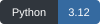
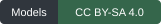
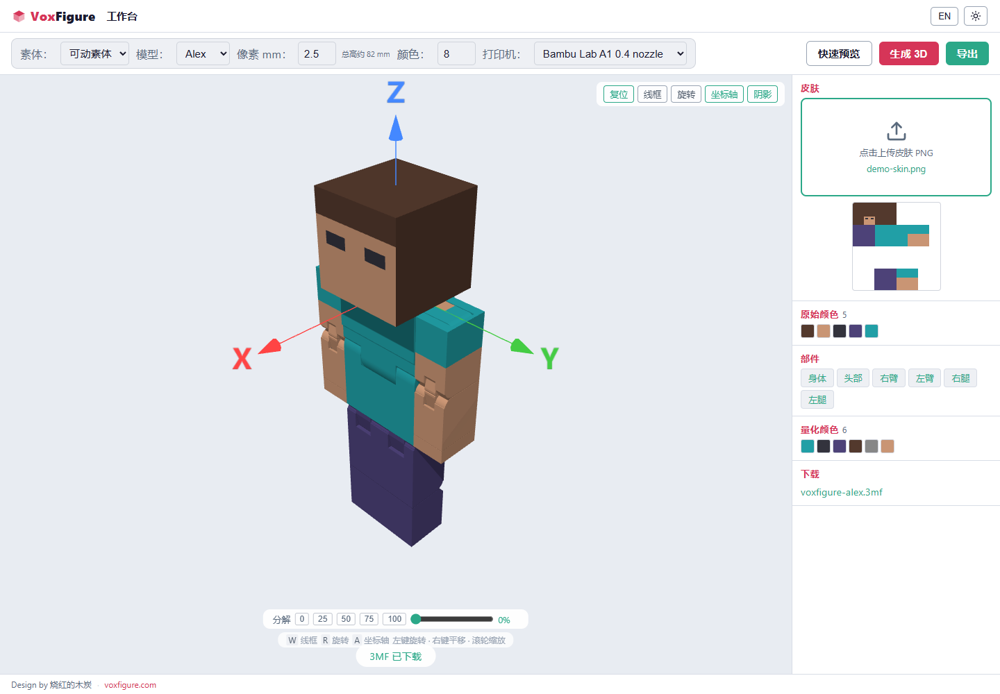

<p align="center">
  <a href="https://voxfigure.com"></a>
</p>
<h1 align="center">VoxFigure</h1>
<p align="center">将 Minecraft 皮肤转换为普通 Steve / Alex 可动素体的多色 3D 打印模型。</p>
<p align="center"><strong>简体中文</strong> · <a href="README.en.md">English</a></p>
<p align="center">
  <a href="#本地运行" title="Python 3.12"></a>
  <a href="LICENSE"></a>
  <a href="LICENSE-MODELS"></a>
</p>
<p align="center"><a href="#本地运行">安装运行</a> · <a href="#使用">使用说明</a> · <a href="#贡献">参与贡献</a> · <a href="https://voxfigure.com">官网</a> · <a href="mailto:voxfigure@163.com">邮件联系</a></p>

<p align="center">
  
  
</p>

VoxFigure 提供皮肤映射、模型预览和彩色 3MF 导出，可独立在本机运行，无需账号和数据库。

## 功能

- 使用随附的 Steve / Alex STEP 模型生成打印分件，包含胸部平铺件和关节销钉。
- 读取 PNG 皮肤，支持透明层和颜色量化，可调整每像素尺寸及颜色数量。
- 支持部件显隐、分解查看、线框、坐标轴和光影；界面可切换中英文及深浅主题。
- 按当前皮肤和参数导出分件彩色 3MF，供切片软件继续处理。

## 本地运行

使用 Python 3.12，在仓库根目录创建虚拟环境并安装依赖。

**Windows PowerShell**

```powershell
py -3.12 -m venv .venv
.\.venv\Scripts\python.exe -m pip install -r requirements.txt
.\.venv\Scripts\python.exe app.py
```

**macOS / Linux**

```sh
python3.12 -m venv .venv
.venv/bin/python -m pip install -r requirements.txt
.venv/bin/python app.py
```

打开 http://127.0.0.1:5000 。

首次生成会读取 STEP 并建立几何缓存，可能需要几分钟；后续生成复用缓存。Linux 所需的系统图形库可参考 [Dockerfile](Dockerfile)。安装依赖后可离线运行，前端不需要外部 CDN。

<details>
<summary>Docker Compose</summary>

```sh
docker compose up --build
```

访问地址同样为 http://127.0.0.1:5000 。默认只绑定本机，几何缓存保存在命名卷。停止服务：

```sh
docker compose down
```

当前 Docker 配置尚未实跑验证。

</details>

## 使用

1. 上传 PNG 皮肤，选择 Steve 或 Alex。
2. 调整每像素尺寸和颜色数量，点击「快速预览」检查外观。
3. 点击「生成 3D」，查看真实打印分件。更换皮肤或参数后需要重新生成。
4. 从「导出」菜单下载 3MF，在切片软件中核对耗材、摆盘和支撑。

支持的皮肤尺寸为 `64×64`、`64×32`、`128×128` 和 `128×64`，文件不超过 2 MB。每像素尺寸为 1–5 mm，最多颜色参数为 2–32。

128 像素皮肤沿用普通素体的取样规则，不会增加模型的几何分辨率。2.5 mm / 像素对应完整皮肤外形约 82 mm 高，透明层可能使实际高度略小。

<details>
<summary>查看工作台截图</summary>



Alex 皮肤映射与打印分件预览。

</details>

上传皮肤和生成的导出文件在请求结束后从临时目录清除。下载时会根据当前皮肤重新生成模型。几何缓存默认位于 `.cache`，可通过 `VOXFIGURE_CACHE` 修改位置。

## 测试

使用前面创建的虚拟环境执行（Windows PowerShell）：

```powershell
.\.venv\Scripts\python.exe -m pip install -r requirements-dev.txt
.\.venv\Scripts\python.exe -m pytest -q
```

完整 STEP 与 3MF 集成测试需要 CadQuery / OCP，耗时较长：

```powershell
.\.venv\Scripts\python.exe -m pytest -m cad -q
```

macOS / Linux 将解释器路径替换为 `.venv/bin/python`。

浏览器验收脚本为 [tests/browser.cjs](tests/browser.cjs)。环境配置、项目结构和测试方法见 [开发说明](docs/DEVELOPMENT.md)。

## 贡献

欢迎提交 Issue 或 Pull Request。问题报告请包含操作系统、Python 版本、复现步骤和错误日志；涉及模型生成时，请说明角色、皮肤尺寸与生成参数。

修改前可先阅读 [开发说明](docs/DEVELOPMENT.md)。提交功能变更时，请运行相关测试，并附上界面或导出结果的说明。较大的功能调整建议先通过 Issue 讨论。

## 联系

- 项目网站：[voxfigure.com](https://voxfigure.com)
- 联系邮箱：[voxfigure@163.com](mailto:voxfigure@163.com)

## 许可

- 项目代码采用 [AGPL-3.0-only](LICENSE)。
- 普通 Steve / Alex 模型采用 [CC BY-SA 4.0](LICENSE-MODELS)。
- 第三方文件保留各自许可证，见 [THIRD_PARTY_NOTICES.txt](THIRD_PARTY_NOTICES.txt)。

适用范围、模型署名示例和导出物说明见 [LICENSING.md](LICENSING.md)。README 中的模型插图与动画同样采用 CC BY-SA 4.0，署名见 [媒体许可](docs/media/README.md)。

Design by 烧红的木炭 · https://voxfigure.com

本项目是独立第三方工具，与 Mojang、Microsoft 或打印机厂商无官方关联。
